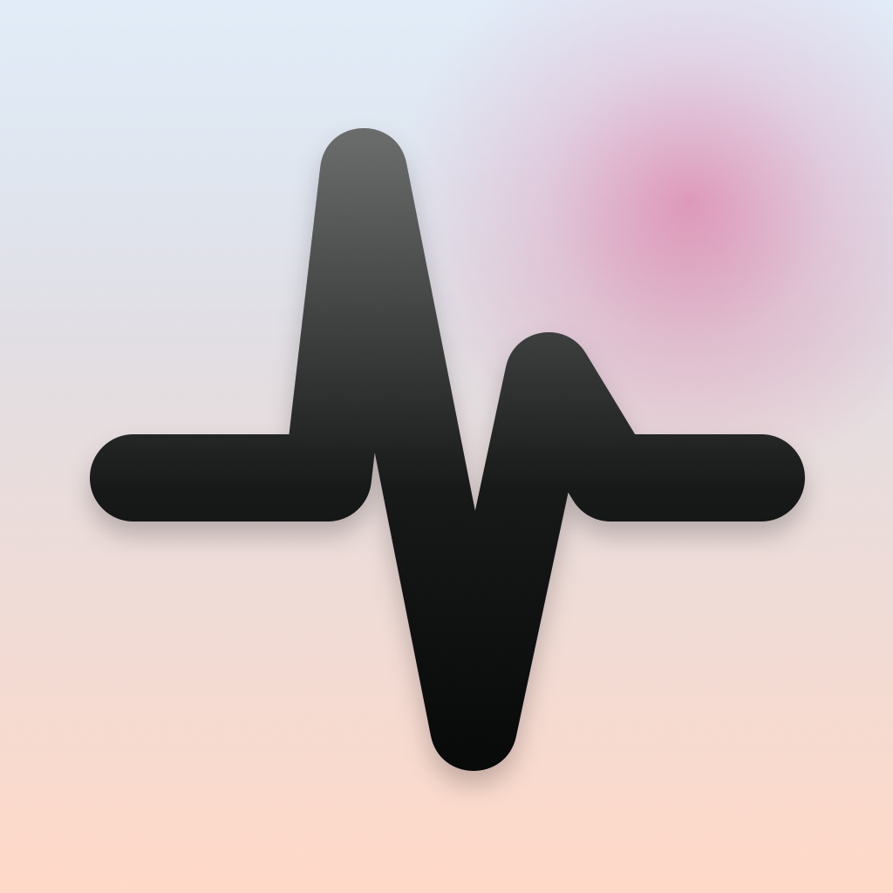
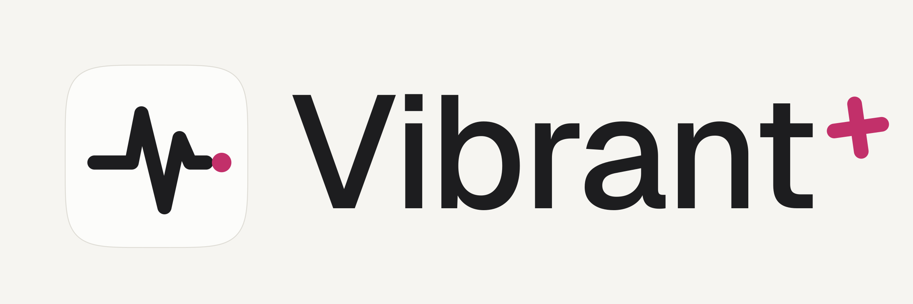
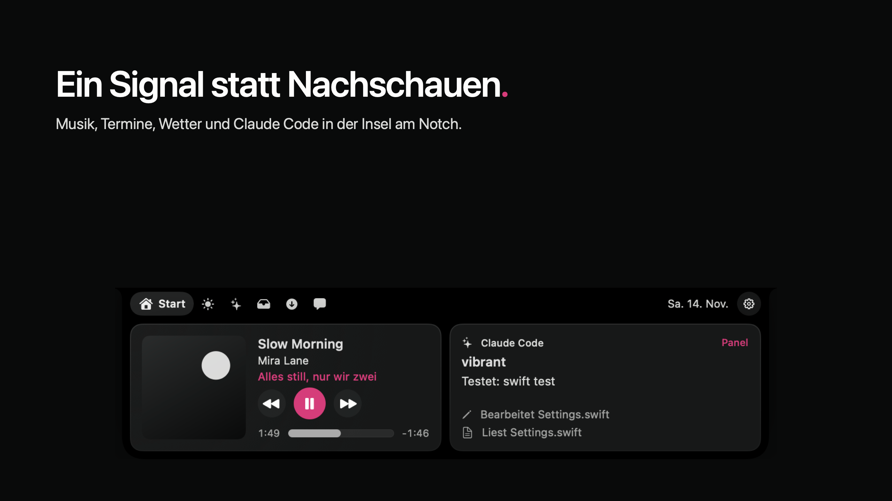
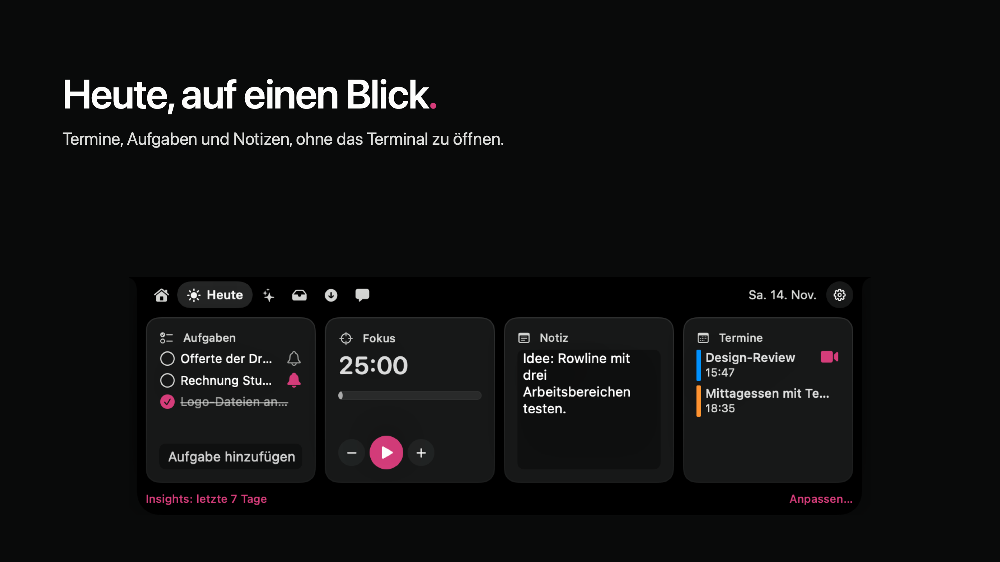
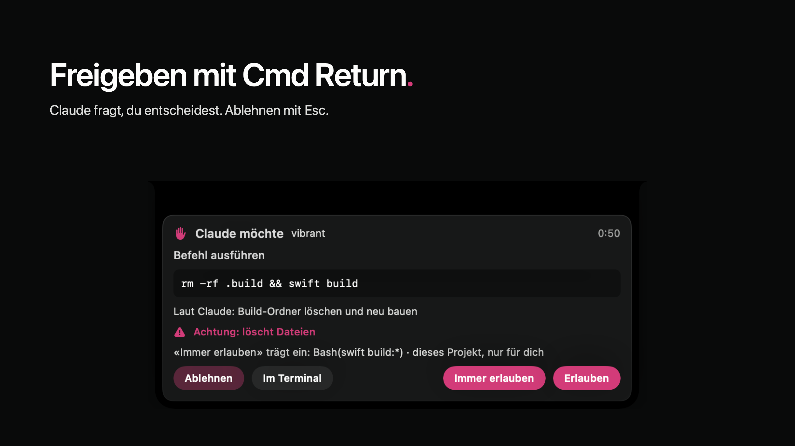
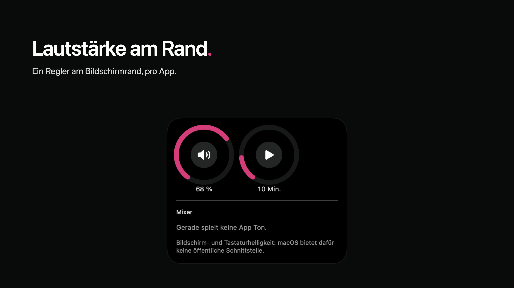
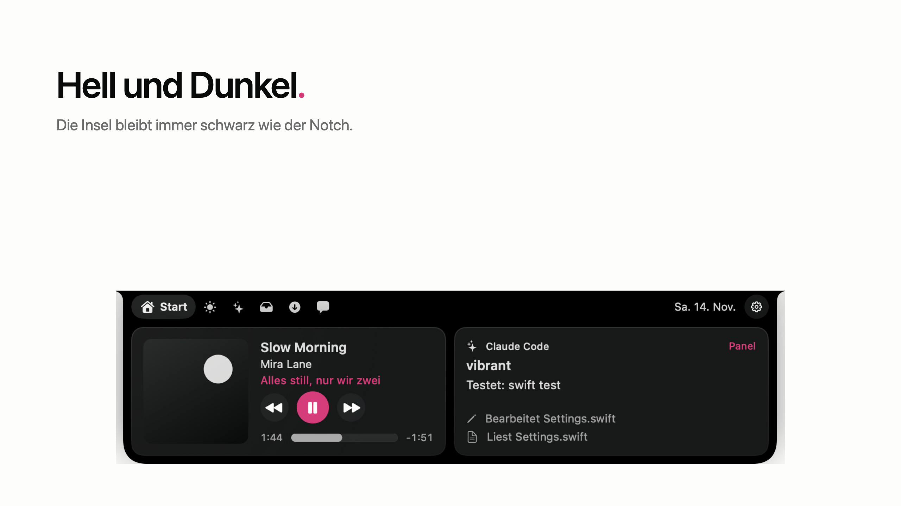
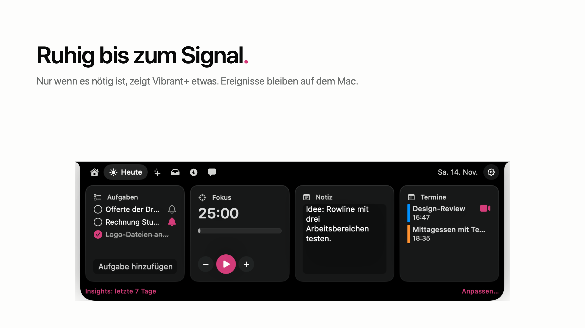

<p align="center">
  
</p>

<p align="center">
  
</p>

<h1 align="center">Vibrant+</h1>

<p align="center">
  <strong>Der Notch wird zur Insel.</strong><br>
  Native macOS-Menüleisten-App von ARJO LAB — Musik, Termine, Wetter, Aufgaben,<br>
  Claude Code, Dateiumwandlung, Fensterreihen, Lautstärke pro App, Diktieren und mehr.
</p>

<p align="center">
  <a href="https://github.com/ArijanVr/VibrantPL/releases/latest"></a>
  <a href="LICENSE"></a>
  <a href="https://arjolab.ch/vibrant-plus"></a>
  
  
</p>

<p align="center">
  <a href="#installieren">Installieren</a> ·
  <a href="#einblicke">Einblicke</a> ·
  <a href="#videos">Videos</a> ·
  <a href="#kurzbedienung">Bedienung</a> ·
  <a href="https://arjolab.ch/vibrant-plus">Produktseite</a>
</p>

---

## Installieren

**Voraussetzungen:** macOS 26 (Tahoe) oder neuer, Apple silicon (M-Chip).

### Fertige App (empfohlen)

1. Lade das neueste Release herunter: **[Vibrant+-1.2.0.zip](https://github.com/ArijanVr/VibrantPL/releases/download/v1.2.0/Vibrant%2B-1.2.0.zip)**  
   (oder die [Release-Seite](https://github.com/ArijanVr/VibrantPL/releases/latest))
2. Öffne die ZIP-Datei (Doppelklick).
3. Ziehe **Vibrant+.app** in den Ordner **Programme** (`/Applications`).
4. Starte Vibrant+ aus dem Programme-Ordner (Rechtsklick › **Öffnen**, falls macOS beim ersten Start nachfragt).
5. Das Symbol erscheint in der **Menüleiste** — nicht im Dock.
6. Bewege die Maus auf den Notch (oder drücke **⌃⌥⌘I**), um die Insel zu öffnen. Berechtigungen (Kalender, Erinnerungen, Mikrofon …) erlaubst du erst, wenn eine Funktion sie braucht.

**Prüfen:** Menüleistensymbol ist sichtbar; Notch-Hover öffnet die Insel.

SHA-256 von `Vibrant+-1.2.0.zip`:

```text
f0a5cf93ae75d5f216c73efa2e457bd233c75584156d18b3ae7b28b524484ec0
```

### Neuinstallation / von älteren Builds umsteigen

Ab 1.0.0 geht das auch direkt in der App: **Einstellungen › App-Updates**. Vibrant+ beendet sich dabei selbst und startet die neue Fassung.

1. Vibrant+ vollständig beenden (Menüleiste › Beenden).
2. Alte `/Applications/Vibrant+.app` durch die neue Version ersetzen.
3. Neu starten; bei Bedarf Berechtigungen erneut erlauben.

Lokale Daten unter `~/Library/Application Support/VibrantPlus/` bleiben erhalten. Die Bundle-ID bleibt `ch.arjo.vibrantplus`.

### Aus dem Quellcode bauen

```bash
git clone https://github.com/ArijanVr/VibrantPL.git
cd VibrantPL
./build.sh --open
```

Zusätzlich brauchst du Xcode 26+ und XcodeGen (`brew install xcodegen`). Optional: Claude Code, `yt-dlp`, `ffmpeg`.

```bash
swift test --scratch-path ~/Library/Developer/VibrantPlus/test-build
tools/selftest.sh
```

---

## Einblicke

<p align="center">
  
</p>

| Insel & Start | Heute |
|:---:|:---:|
|  |  |

| Freigaben | Rand-Regler |
|:---:|:---:|
|  |  |

| Heller Modus | Ruhe |
|:---:|:---:|
|  |  |

Weitere Produktfotos und Marke: Ordner [`docs/media/`](docs/media/).

---

## Videos

| Video | Link |
|---|---|
| Produktfilm 1.0 (Website) | [arjolab.ch — Vibrant+ Film](https://arjolab.ch/media/vibrant-1.0.0-film-5dde48604529.mp4) |
| Werbevideo 1.0 (16:9, mit Ton) | [Download auf GitHub Releases](https://github.com/ArijanVr/VibrantPL/releases/download/v1.0.0/Vibrant-Plus_Werbevideo_1-0_16x9_Ton_v2.mp4) |
| Pulsi-Erklärvideo (16:9) | [Download auf GitHub Releases](https://github.com/ArijanVr/VibrantPL/releases/download/v1.0.0/Vibrant-Plus_Pulsi-Erklaervideo_16x9_v2.mp4) |

Produktseite mit eingebettetem Film: [arjolab.ch/vibrant-plus](https://arjolab.ch/vibrant-plus)

<video src="https://arjolab.ch/media/vibrant-1.0.0-film-5dde48604529.mp4" controls width="720" poster="docs/media/produkt-insel.png">
  Dein Browser zeigt das Video hier nicht an — nutze die Links oben.
</video>

---

## Was Vibrant+ kann

- **Insel am Notch** — Musik, Termine, Wetter, Aufgaben auf einen Blick
- **Claude Code** — Live-Status und Berechtigungen in der Insel
- **Stow** — Dateien umwandeln per Drag & Drop auf den Notch
- **Rowline** — Fensterreihen per Kurzbefehl
- **Rand-Regler** — Lautstärke pro App am Bildschirmrand
- **Diktieren** — Sprache zu Text halten und sprechen
- **App-Raster**, Tastengeräusche, Downloads per Link und mehr

Version **1.2.0** ist das aktuelle Release: die neue Marke «Porzellan trägt, Tinte spricht, Puls zeigt.» mit Icon A, Lichtsaum und Porzellan-Pulsi. 1.1.1 brachte übersichtlichere Einstellungen, 1.1.0 die neu gestaltete Insel, die Codex-Anbindung, neue Kacheln und die Update-Karte. Auto-Updates zeigen hierher; Vibrant+ lädt neue Fassungen direkt in der App.

---

## Kurzbedienung

| Was | Wie |
|---|---|
| Insel öffnen | Maus auf den Notch, oder **⌃⌥⌘I** |
| Datei umwandeln | Datei auf den Notch ziehen |
| Claude Code | Einstellungen › Claude Code › verbinden |
| Rowline | **⌃⌥⌘F** und Nachbartasten (siehe Einstellungen › Kurzbefehle) |
| Diktieren | **⌃⌥** bzw. **⌃⌘** halten und sprechen |

---

## Datenschutz und Netzwerk

Daten liegen lokal unter `~/Library/Application Support/VibrantPlus/`. Keine Konten, keine Analyse, keine Telemetrie.

Ins Netz (HTTPS) gehen nur Funktionen, die du nutzt:

- Wetter: Open-Meteo (Stadtname)
- Spotify-Cover: Cover-URL
- Umrechner: frankfurter.dev (Kurse, kein Betrag)
- Liedtexte: LRCLIB
- Optionale Downloads: Ziele, die du angibst (`yt-dlp`)
- Optional Updates: GitHub Releases dieses Repos (Schalter standardmässig aus)

---

## Dokumentation

- [`ARCHITECTURE.md`](ARCHITECTURE.md) — Aufbau
- [`CONTRIBUTING.md`](CONTRIBUTING.md) — Mitwirken
- [`SECURITY.md`](SECURITY.md) — Sicherheitslücken melden
- [`CHANGELOG.md`](CHANGELOG.md) — Änderungen
- [`docs/DESIGN_SYSTEM.md`](docs/DESIGN_SYSTEM.md) — Design-Tokens
- [`docs/media/`](docs/media/) — Logo, Icon, Produktfotos

---

## Marke und Lizenz

Vibrant+ ist freie Software unter der **GNU General Public License, Version 3 oder (nach deiner Wahl) jeder späteren Version**. Siehe `LICENSE` und `NOTICE`.

Der Name «Vibrant+», Logo und Icon sind Marken von ARJO LAB und **nicht** durch die GPL abgedeckt.

Funktionskonzepte wurden eigenständig umgesetzt. Kein fremder proprietärer Code und keine fremden Assets.
